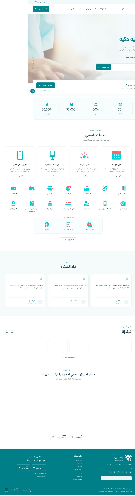
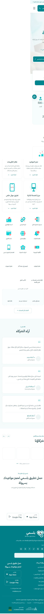

<div dir="rtl" align="right">

# بلسمي | منصتك لحلول صحية ذكية

موقع عربي متعدد الصفحات يعيد تقديم محتوى [بلسمي الأصلي](https://blsmy.com/) بتصميم أحدث ومتجاوب، واتجاه RTL وحركات خفيفة تراعي إعداد تقليل الحركة.

[زيارة الموقع](https://abomosaa.github.io/blsmy/) · [ملاحظات الموقع](docs/NOTES.md)

## بأي لغة بُني؟

**Angular 21 وTypeScript** لمنطق الواجهة، و**HTML وCSS** للتصميم. المحتوى باللغة العربية، والنشر عبر GitHub Pages وGitHub Actions.

## ما الذي يحتويه؟

الرئيسية تتبع ترتيب الموقع الأصلي تقريبًا: المقدمة، حجز الموعد، الإحصاءات، الخدمات، آراء الشركاء، الشركاء، صور التطبيق والتذييل. تضم **21 خدمة و25 شعار شريك و5 لقطات فعلية للتطبيق**، مع الشعار والصور الأصلية محفوظة محليًا.

يتوفر الحجز بالطريقتين: **فتح نظام بلسمي الأصلي** للمواعيد المباشرة، أو **تجهيز طلب عبر واتساب** ومراجعته قبل الإرسال. البحث العام يفتح نتائج منصة بلسمي الأصلية، والدليل المحلي يسمح بالبحث في أسماء الشركاء المعروضين.

| الصفحة           | المسار           |
| ---------------- | ---------------- |
| الرئيسية         | `/`              |
| خدمات بلسمي      | `/services`      |
| المراكز والشركاء | `/hospitals`     |
| الخدمات والعروض  | `/offers`        |
| حلول المراكز     | `/prices`        |
| عن بلسمي         | `/about`         |
| طلب الموعد       | `/book`          |
| التواصل          | `/contact`       |
| الانضمام للفريق  | `/jobs`          |
| الخصوصية         | `/privacy`       |
| بوابة المراكز    | `/medical-login` |

## الرئيسية — الكمبيوتر



## الرئيسية — الجوال



## التشغيل

المتطلبات: Node.js **22.12 أو أحدث ضمن 22**، أو إصدار **24**، وnpm.

</div>

```bash
npm ci
npm start
```

<div dir="rtl" align="right">

افتح `http://localhost:4200`. للبناء ومعاينة المخرجات:

</div>

```bash
npm run build
node scripts/preview.mjs
```

<div dir="rtl" align="right">

المخرجات في `dist/blsmy/browser`. كل تحديث إلى `main` يشغّل النشر تلقائيًا. تجهيز طلب واتساب لا يؤكد موعدًا، ولا يرسل الرسالة تلقائيًا؛ الحجز والتوفر النهائيان يتبعان المركز والنظام الأصلي.

</div>
